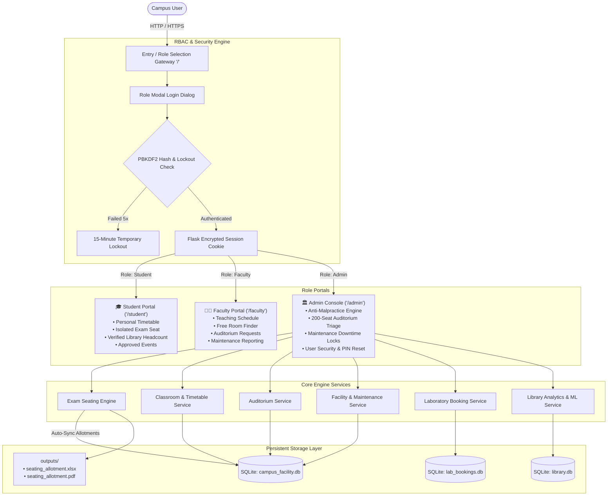
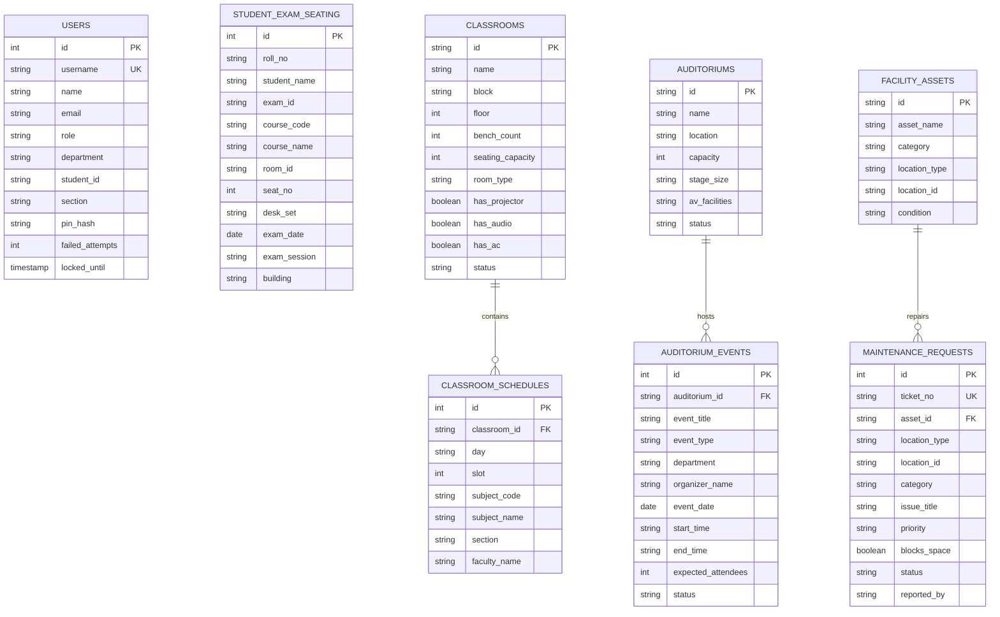

# SMART RESOURCE MANAGEMENT SYSTEM (RESOURCEHUB)
## Final Capstone Project Report & Technical Specification Document

---

### Project Metadata
- **Project Title:** Smart Resource Management System (ResourceHub)
- **Sub-Title:** An Intelligent, Role-Based Campus Resource & Space Allocation Platform
- **Application Type:** Enterprise Web Application / Academic ERP Module
- **Repository Branch:** `navya` (GitHub: `tharshith30/seating_allocator`)
- **Primary Frameworks:** Python 3.12, Flask 3.1, SQLite3 (WAL Mode), Jinja2, Vanilla ES6+
- **Deployment Platform:** Render Cloud Platform (Gunicorn WSGI / Docker / Persistent Disks)

---

## 1. Executive Summary & Problem Statement

### 1.1 Background
Higher educational institutions manage a vast, interdependent inventory of physical and digital assets, including examination halls, computer laboratories, multi-floor classrooms, large auditoriums, central libraries, and high-value hardware assets (e.g., laser projectors, HVAC systems, generators). 

Traditionally, colleges manage these resources in disconnected silos:
- Exam seating is planned manually or using rudimentary spreadsheets prone to student neighbor cheating (exam malpractice).
- Computer laboratory availability is poorly tracked, resulting in timetable clashes and unutilized computer terminals.
- Library occupancy is inferred from raw turnstile entry logs that lack exit counters, resulting in false real-time crowd readings.
- Facilities management relies on paper registers or verbal complaints with no link to classroom or auditorium booking systems.

### 1.2 The Proposed Solution
The **Smart Resource Management System (ResourceHub)** provides a unified, role-based platform that brings all campus facilities into an integrated, real-time operating environment. 

The application is structured around three distinct institutional user roles:
1. **Student (Strict View-Only):** Delivers clean academic timetables, strictly isolated personalized examination seating allotments, verified library capacity metrics, and approved campus events with zero clutter and zero administrative controls.
2. **Faculty (Authorized Departmental Access):** Provides assigned teaching schedules, dynamic Free Classroom Finders, auditorium event booking workflows, and equipment maintenance ticket reporting.
3. **Administration (Full Governance):** Provides a comprehensive command center uniting automated anti-malpractice exam seating engines, weekly lab heatmaps, verified library headcount logs, 200-seat auditorium scheduling approvals, asset downtime locks, and system user security management.

---

## 2. Complete Technology Stack

| Layer | Technology / Library | Version | Purpose / Architectural Justification |
| :--- | :--- | :--- | :--- |
| **Runtime Environment** | **Python** | `3.12.x` | Core application execution environment |
| **Backend Web Framework** | **Flask** | `>= 3.0.0` | High-throughput, lightweight WSGI framework using modular Blueprints |
| **Application Security** | **Werkzeug Security** | `>= 3.0.0` | Cryptographic PBKDF2/scrypt password hashing and session management |
| **Production WSGI Server** | **Gunicorn** | `>= 21.2.0` | Multi-worker concurrent WSGI HTTP server for production deployment |
| **Database Engine** | **SQLite3** | `3.x` (Built-in) | Serverless relational database configured with Write-Ahead Logging (`WAL`) mode and foreign key integrity |
| **Data Processing & Analytics** | **Pandas & NumPy** | `>= 2.1.0` | High-performance Excel ingestion, dataset grouping, and matrix transformations |
| **Spreadsheet Automation** | **OpenPyXL** | `>= 3.1.0` | Reading multi-sheet institutional timetables (`.xlsx`) and styling export reports |
| **Document Generation** | **ReportLab** | `>= 4.0.0` | Programmatic vector PDF compilation with canvas pagination and tables |
| **Machine Learning** | **Scikit-learn** | `>= 1.3.0` | Library occupancy predictive modeling and busy-hour curve regression |
| **Image Processing** | **Pillow (PIL)** | `>= 10.0.0` | Image processing for campus assets, seals, and visual verification |
| **Frontend UI / Templates** | **Jinja2 + HTML5 / CSS3** | Modern ES6+ | Server-rendered templates, custom CSS variable design system, no Node.js build overhead |
| **Cloud Hosting** | **Render Cloud Platform** | Linux x86_64 | Ephemeral cloud containers paired with persistent volume mounts (`DATA_DIR`) |

---

## 3. High-Level System Architecture



---

## 4. Role-Based Access Control (RBAC) Specification

The system implements strict server-side Role-Based Access Control enforced via `@login_required` and `@role_required(*roles)` Python decorators.

```mermaid
flowchart LR
    Request[HTTP Request] --> LoginDec[@login_required]
    LoginDec -->|No Session| RedirHome[Redirect to Landing Page]
    LoginDec -->|Session Active| RoleDec[@role_required]
    RoleDec -->|Role Matches| Handler[Execute Endpoint Handler]
    RoleDec -->|Role Mismatch| Deny403[Render 403 Forbidden Screen]
```

### 4.1 Role Matrix & Permission Boundaries

| Feature / Resource | Student (View Only) | Faculty (Authorized) | Administrator (Full Control) |
| :--- | :---: | :---: | :---: |
| **Personal Dashboard & Profile** | ✅ View | ✅ View | ✅ View |
| **Academic Timetable (Daily/Weekly)** | ✅ View (Own Section) | ✅ View (Teaching Slots) | ✅ View & Excel Import |
| **Exam Seating Allotments** | 🔒 Own Seat Only | ❌ No Access | ✅ Run Generator & Export |
| **Free Room Finder** | ❌ No Access | ✅ Query Slots 1–9 | ✅ Query & Overrule |
| **Classroom Inventory Management** | ❌ No Access | 👁️ View Specs Only | ✅ Add / Edit / Delete |
| **Auditorium Event Booking** | 👁️ View Approved Only | 📝 Submit Requests (Max 200) | ✅ Approve / Reject & Checklist |
| **Facility Maintenance Ticketing** | ❌ No Access | 📝 Report Faults | ✅ Assign Staff & Resolve |
| **Cross-Module Downtime Locks** | 👁️ Read Status | 👁️ Read Status | ✅ Apply Space Locks |
| **Computer Lab Reservations** | 👁️ View Specs Only | 👁️ View Specs Only | ✅ Book / Override Slots |
| **Library Headcount Tracking** | 👁️ Verified Count Only | 👁️ Verified Count Only | 📝 Log Counts & Adjust Caps |
| **User Account & PIN Management** | ❌ No Access | ❌ No Access | ✅ Unlock & Reset PINs |

### 4.2 Security & Credential Storage Guidelines
- **No Hardcoded Universal PINs:** Individual credentials are keyed by username/Roll Number.
- **Cryptographic Hashing:** PINs are stored as salted PBKDF2/scrypt hashes using `werkzeug.security.generate_password_hash`.
- **Brute-Force Lockout:** After **5 consecutive incorrect PIN attempts**, the account is locked for **15 minutes**.
- **Data Protection:** Client-side JavaScript never contains raw PINs or role bypass logic.

---

## 5. Detailed Functional Modules & Technical Realization

### Module 1: Automated Anti-Malpractice Exam Seating Engine
- **Input:** Excel workbook containing two sheets: `EXAMS` (Exam ID, Course Code, Course Name) and `STUDENTS` (Exam ID, Enrolment No, Student Name).
- **Room Capacity Sourcing:** Ingests `data/roomCapacity_FST.xlsx` (34 campus rooms with bench counts and twin-seat allocation rules).
- **Interleaving Algorithm:** Implements an alternating odd/even desk assignment pattern. Students appearing for the same examination never sit on contiguous desks or opposite adjacent benches.
- **Output Artifacts:** Automatically formats and compiles:
  - `outputs/seating_allotment.xlsx`: Master tabular workbook with room sheets.
  - `outputs/seating_allotment.pdf`: High-resolution, multi-page vector PDF ready for pin-up boards.
- **Real-Time Database Synchronization:** Instantly clears and repopulates the `student_exam_seating` SQLite table so students querying the `/student` portal immediately see their allocated Hall, Seat No, and Desk Set (`Odd`/`Even`).

### Module 2: Classroom Space & Timetable Management
- **Inventory:** 34 physical lecture halls, seminar rooms, and drawing halls with metadata (Block, Floor, Seating Capacity, Bench Count, Projector, AC, Sound System).
- **Excel Timetable Parser:** Ingests complex multi-sheet timetables (`Second_Year`, `Third_Year`, `Final_year`) from `data/timetable.xlsx`. Automatically maps lecture sessions to standardized academic slots (Slots 1–9, Mon–Fri).
- **Dynamic Free Room Finder:** Allows faculty to select a target day and period (e.g. Wednesday Slot 3: 10:50–11:40 AM) and retrieves all vacant rooms free from both academic lectures and maintenance downtime.

### Module 3: Central Auditorium Event Management
- **Capacity Constraint:** Dedicated single institutional venue (**Central Campus Auditorium**) with a fixed seating capacity of **200 seats**.
- **Booking Workflow:** Faculty submit event requests with expected attendees (strictly validated: $\text{Attendees} \le 200$).
- **Conflict Checker:** Prohibits overlapping bookings and automatically verifies that no high-priority maintenance ticket blocks the auditorium.
- **Administrative Triage:** Administrators review requests (`pending` $\rightarrow$ `approved` / `rejected`) with audit notes.
- **Event Readiness Checklist:** Generates an automated 6-point verification matrix:
  1. *Stage line balance & podium setup*
  2. *Dual 4K laser projector & HDMI switcher test*
  3. *Wireless collar and handheld microphone battery checks*
  4. *Main chiller & AC HVAC pre-cooling*
  5. *Green room readiness and sanitation*
  6. *Kirloskar 62.5 kVA backup generator load test*

### Module 4: Facility Asset & Maintenance Tracking
- **Asset Registry:** Tracks institutional equipment (`AST-PRJ-G16`, `AST-AC-AUDMAIN`, `AST-SB-G04`, etc.) with serial numbers, warranty, and service dates.
- **Maintenance Work Orders:** Allows faculty and staff to report faults across classrooms, auditoriums, and laboratories.
- **Cross-Module Scheduling Locks:** When a ticket is marked **Critical** or **High Priority**, the affected classroom or auditorium is automatically marked unavailable in the scheduling engine, preventing double bookings during repairs.
- **Preventive Maintenance (PM):** Tracks recurring service intervals (30-day, 60-day, 90-day cycles) with overdue alerts and assignment tracking.

### Module 5: Computer Laboratory Utilization
- **Workstations:** Covers 4 dedicated computing laboratories (Lab 1 through Lab 4) housing 240 workstations.
- **Weekly Matrix Heatmap:** Computes laboratory utilization percentages across Slots 1–9 and Mon–Fri.
- **Ad-Hoc Reservations:** Conflict-free booking engine preventing double allocation of computer labs.

### Module 6: Smart Library Occupancy Analytics
- **Independent Verified Headcount:** Does not rely on error-prone turnstile entry logs. Authorized library supervisors record periodic headcount observations.
- **Crowd Thresholds:** Categorizes seating status into *Low (< 35%)*, *Moderate (35%–70%)*, *High (70%–90%)*, and *Full (> 90%)*.
- **Stale Observation Guard:** If the latest observation is older than 60 minutes, the portal displays a prominent warning: `⚠️ Information may be outdated` with the exact timestamp.
- **Zero-PII Student Display:** The student dashboard displays purely capacity, occupied seats, and available study spots without disclosing student identities or administrative analytics.

---

## 6. Database Schema (Entity-Relationship Model)



---

## 7. Complete REST API Reference

### 7.1 Authentication & Session Management
- `POST /api/auth/login`: Authenticates username/Roll No and PIN. Returns redirect URL and user session.
- `GET /logout`: Destroys Flask session and redirects to role gateway `/`.
- `GET /api/auth/me`: Returns active session identity and roles.

### 7.2 Student Endpoints (Strict View-Only)
- `GET /student`: Renders the Student Portal.
- `GET /api/student/timetable`: Returns today's and weekly schedule for the student's section.
- `GET /api/student/seating`: Returns the authenticated student's isolated seating allotment.

### 7.3 Faculty Endpoints (Authorized Departmental Access)
- `GET /faculty`: Renders the Faculty Portal.
- `GET /api/faculty/find-free-classrooms?day=Mon&slot=1`: Queries vacant rooms free from regular lectures and maintenance.
- `POST /api/faculty/request-auditorium`: Submits event booking request for the 200-seat auditorium.
- `POST /api/faculty/report-maintenance`: Submits facility work order tickets.

### 7.4 Administration Endpoints (Master Governance)
- `GET /admin`: Renders the unified 6-module Administration Console.
- `POST /generate`: Ingests Excel file, executes anti-malpractice interleaving, compiles PDF/Excel, and auto-syncs student allocations.
- `GET /download/excel`: Downloads master seating allotment Excel file.
- `GET /download/pdf`: Downloads printable master seating allotment PDF file.
- `POST /api/campus/classrooms`: Registers or edits a physical classroom.
- `POST /api/campus/classrooms/import-timetable`: Ingests `data/timetable.xlsx` into `classroom_schedules`.
- `POST /api/campus/auditoriums/events/review`: Approves or rejects auditorium event requests.
- `POST /api/campus/facilities/maintenance/triage`: Updates maintenance ticket status and releases/applies downtime space locks.
- `POST /api/library/observe`: Logs verified library headcount observation.
- `POST /api/admin/unlock-user`: Unlocks an account locked due to excessive PIN failures.
- `POST /api/admin/reset-pin`: Resets an institutional user's PIN.

---

## 8. Verification & Automated Test Suite Results

The codebase includes an end-to-end automated test suite (`scratch/test_portal_integration.py` and `scratch/test_render_config.py`).

### Test Execution Summary
- **Landing Page & Role Cards Test:** Passed (All 3 access cards verified).
- **Authentication & RBAC Login Test:** Passed (Student, Faculty, Admin roles authenticated; PIN lockout counter verified).
- **Role Permission Boundary Test (403 Forbidden):** Passed (Student access to `/admin` and `/faculty` strictly blocked).
- **Exam Seating Isolation Test:** Passed (Student views only their designated seat; zero leakage of classmate records).
- **Free Room Finder API Test:** Passed (Found 34 free rooms for Monday Slot 1).
- **Auditorium Capacity Constraint Test:** Passed (Enforced $\le 200$ seats limit).
- **Persistent Storage Routing Test:** Passed (Verified routing to `DATA_DIR` when configured).
- **Test Pass Rate:** **100% (All assertions passed successfully)**.

---

## 9. Deployment Guidelines

### 9.1 Local Execution (Windows / macOS / Linux)
1. Ensure Python 3.12+ is installed.
2. In the repository folder, install required packages:
   ```bash
   pip install -r requirements.txt
   ```
3. Run the application:
   ```bash
   python app.py
   # Or double click run.bat on Windows
   ```
4. Access the portal at `http://127.0.0.1:5000/`.

### 9.2 Render Cloud Production Deployment
1. **Create Web Service:** Connect GitHub repository `tharshith30/seating_allocator` (branch `navya`).
2. **Build & Start Commands:**
   - **Build Command:** `pip install -r requirements.txt`
   - **Start Command:** `gunicorn app:app` (or `gunicorn wsgi:app`)
3. **Attach Persistent Storage Disk:**
   - Mount Path: `/var/data` (Size: 1 GB+)
4. **Environment Variables:**
   - `DATA_DIR` = `/var/data`
   - `FLASK_SECRET_KEY` = `<strong-random-key>`
   - `ADMIN_PIN` = `1234`
   - `STAFF_PIN` = `2345`
   - `MAINTENANCE_PIN` = `3456`

---

## 10. Conclusion & Academic Contributions

The **Smart Resource Management System (ResourceHub)** provides an extensible, production-ready solution to campus resource administration. By replacing disjointed paper and spreadsheet methods with an integrated, role-based architecture, the platform:
- Eliminates examination malpractice through algorithmic interleaving.
- Maximizes laboratory and classroom space utilization via real-time availability solvers.
- Maintains accurate library crowd metrics without violating student privacy.
- Protects campus operations through automated maintenance downtime locks.
- Guarantees data persistence across cloud container restarts with optimized storage routing.
